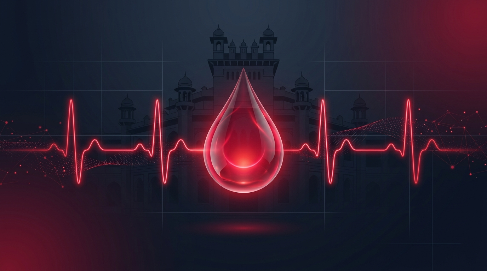
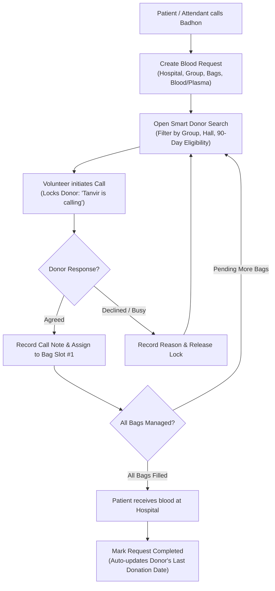

[](https://app.netlify.com/projects/dubadhon/deploys)

<p align="center">
  
</p>


<p align="center">
  <strong>বাঁধন (স্বেচ্ছায় রক্তদাতাদের সংগঠন) — ঢাকা বিশ্ববিদ্যালয়</strong><br>
  <em>"একের রক্ত অন্যের জীবন, রক্তই হোক আত্মার বাঁধন"</em>
</p>

<p align="center">
  <a href="https://nextjs.org"></a>
  <a href="https://react.dev"></a>
  <a href="https://www.typescriptlang.org"></a>
  <a href="https://tailwindcss.com"></a>
  <a href="https://lucide.dev"></a>
  <a href="#-installable-progressive-web-app-pwa"></a>
  <a href="#-mobile-android-app-apk--capacitor"></a>
  <a href="#-installable-progressive-web-app-pwa"></a>
  <a href="#-mobile-android-app-apk--capacitor"></a>
</p>

---

## 📌 Overview

**Badhon (বাঁধন)** is a voluntary blood donors' organization founded at Dr. Muhammad Shahidullah Hall, University of Dhaka, in 1997. It is operated entirely by university students to save lives through voluntary blood donation, free blood group screening, and emergency patient assistance.

This platform is the **official digital coordination & management platform** for DU Badhon club members and hall unit executives. It streamlines daily operations: searching eligible donors, preventing conflicting calls among members, recording emergency blood requests with multi-bag fulfillment, tracking communication logs, and maintaining comprehensive donation records.

---

## ✨ Key Capabilities & Features

### 🔒 1. Live Caller Lock & Collision Prevention
- When a volunteer opens the call modal to reach a donor, a **real-time caller lock** is placed on that donor (e.g., `🔒 Tanvir Hasan calling`).
- Other volunteers browsing the directory immediately see who is currently calling. Action buttons are locked out with explicit warnings to avoid duplicate calls to the same donor.
- If a volunteer closes or finishes the call, the lock is safely released.

### 📞 2. Mandatory Call Logs & Feedback History
- Every call made by a volunteer records:
  - **Outcome**: `Agreed to Donate`, `Declined / Unavailable`, `Phone Switched Off / No Answer`, or `Call Back Later`.
  - **Mandatory Comment**: Detailed feedback (e.g., *"Available after 4 PM at DMCH"*, *"Has mild cold, try next week"*).
  - **Timestamp & Attribution**: Automatically tags which volunteer recorded the note.
- Full call log history is accessible directly on each donor's card.

### 🩸 3. Multi-Bag & Plasma (Apheresis) Requests
- Handles complex blood donation requirements:
  - Supports multiple bags (e.g., 2 bags, 3 bags, 4 bags) per request.
  - Tracks individual bag slots (`Bag #1`, `Bag #2`, etc.) with independent donor assignment.
  - Supports **Whole Blood** vs **Plasma / Platelets (Apheresis)** toggles.
  - Urgent priority badge for critical emergency patients.
  - Visual fulfillment progress bar (`0/2 bags managed`, `1/2 bags`, `Fulfilled`).

### ⏳ 4. 90-Day Eligibility & Cooldown Engine
- Built-in medical safety calculator:
  - Calculates cooldown against the donor's `lastDonationDate`.
  - Displays remaining cooldown days (e.g., `Eligible in 18 days`) or marks `Eligible Now`.
  - Emergency donor search automatically prioritizes active, eligible donors.

### 🏛️ 5. Hall Units Directory (University of Dhaka)
- Full support for all 16 residential halls of the University of Dhaka:
  - *Dr. Muhammad Shahidullah Hall, Fazlul Huq Muslim Hall, Shahid Sergeant Zahurul Huq Hall, Jagannath Hall, Salimullah Muslim Hall, Surya Sen Hall, Haji Muhammad Mohsin Hall, Kabi Jasimuddin Hall, A. F. Rahman Hall, Muktijoddha Ziaur Rahman Hall, Bijoy Ekattor Hall, Sir P. J. Hartog Science Hall, Rokeya Hall, Shamsun Nahar Hall, Kabi Sufia Kamal Hall, Bangamata Sheikh Fazilatunnesa Mujib Hall, and Kuwait-Bangladesh Friendship Hall.*
- Filter donors and requests by hall unit, blood group, department, and academic session.

### 🔄 6. Active Volunteer Session Switcher
- Fast executive identity switcher in the top navigation bar.
- Test and simulate multi-volunteer collaboration as Unit President, General Secretary, Blood Affairs Secretary, or Hall Coordinator.

### 🎨 7. Modern Badhon Crimson Theme & Lucide React Icons
- Custom Badhon Crimson palette (`#E11D48` / `#BE123C`).
- Seamless Dark & Light mode support powered by `next-themes`.
- Vector SVG icons via `lucide-react` (zero keyboard emojis).

### 📱 8. Progressive Web App (PWA) — Install on Phone or Laptop
- **One-Click Installation**: Installable directly from Chrome, Edge, Brave, and Android browsers via the native install icon in the URL bar or the in-app **"Install App"** button.
- **iOS Safari Support**: Guided instructions for adding the app directly to iOS Home Screen via the Share sheet (`Add to Home Screen`).
- **Offline & Standalone**: Runs in dedicated standalone window mode without browser bars, with offline caching for essential assets and emergency workflows.

---

## 📲 How to Install the App (PWA)

### 💻 On Desktop / Laptop (Chrome, Edge, Brave, Opera)
1. Open the website in your browser.
2. Click the **"Install App"** button in the header, or click the **Install icon (⊕ / 💻)** in the browser's address bar.
3. Confirm **Install**. The app will launch in its own standalone window and appear in your OS Applications / Start Menu.

### 📱 On Android (Chrome, Edge, Samsung Internet)
1. Open the website on your phone.
2. Tap the bottom banner **"Install DU Badhon App"** or tap the browser menu (⋮) -> **"Install app"** / **"Add to Home screen"**.
3. The DU Badhon app icon will appear on your phone's home screen and app drawer.

### 🍏 On iPhone / iPad (Safari)
1. Open the website in **Safari**.
2. Tap the **Share** button (⎋ with arrow) in the bottom toolbar.
3. Scroll down and tap **"Add to Home Screen"** (➕).
4. Tap **Add**. The app will be available on your iOS home screen as an app.

---

## 🤖 Mobile Android App (APK & Capacitor)

In addition to PWA, the platform is configured with **Capacitor Android** for standalone native APK deployment:
- **Direct APK Download**: Available from `/download-app` or directly via [public/downloads/du-badhon.apk](file:///home/saikat/projects/du-badhon/public/downloads/du-badhon.apk).
- **Fast 1-Tap Dialer**: Launches the system phone dialer with donor contact numbers directly.
- **Offline Reliability**: Bundles static Next.js export assets directly inside the APK for instant loading without network delays.

### Android Build Commands
```bash
# 1. Export static web assets
npm run build:mobile

# 2. Sync web assets with Capacitor Android
npx cap sync android

# 3. Assemble Debug APK via Gradle
npm run build:apk
```

---

## 📲 How to Install the App (PWA)

### 💻 On Desktop / Laptop (Chrome, Edge, Brave, Opera)
1. Open the website in your browser.
2. Click the **"Install App"** button in the header, or click the **Install icon (⊕ / 💻)** in the browser's address bar.
3. Confirm **Install**. The app will launch in its own standalone window and appear in your OS Applications / Start Menu.

### 📱 On Android (Chrome, Edge, Samsung Internet)
1. Open the website on your phone.
2. Tap the bottom banner **"Install DU Badhon App"** or tap the browser menu (⋮) -> **"Install app"** / **"Add to Home screen"**.
3. The DU Badhon app icon will appear on your phone's home screen and app drawer.

### 🍏 On iPhone / iPad (Safari)
1. Open the website in **Safari**.
2. Tap the **Share** button (⎋ with arrow) in the bottom toolbar.
3. Scroll down and tap **"Add to Home Screen"** (➕).
4. Tap **Add**. The app will be available on your iOS home screen as an app.

---

## 🤖 Mobile Android App (APK & Capacitor)

In addition to PWA, the platform is configured with **Capacitor Android** for standalone native APK deployment:
- **Direct APK Download**: Available from `/download-app` or directly via [public/downloads/du-badhon.apk](file:///home/saikat/projects/du-badhon/public/downloads/du-badhon.apk).
- **Fast 1-Tap Dialer**: Launches the system phone dialer with donor contact numbers directly.
- **Offline Reliability**: Bundles static Next.js export assets directly inside the APK for instant loading without network delays.

### Android Build Commands
```bash
# 1. Export static web assets
npm run build:mobile

# 2. Sync web assets with Capacitor Android
npx cap sync android

# 3. Assemble Debug APK via Gradle
npm run build:apk
```

---

## 🚀 Technology Stack

| Technology | Purpose |
|---|---|
| **Next.js 16.4.6 (Turbopack)** | React Framework, App Router, Static & Dynamic SSR |
| **Capacitor 8.6.2** | Native Android runtime & WebView container |
| **React 19.3.1 & React DOM 19** | Modern UI rendering & concurrency primitives |
| **TypeScript 5.x** | End-to-end static typing and domain interfaces |
| **Tailwind CSS 3.4** | Modern responsive design and dark-mode styling |
| **Lucide React** | Consistent, scalable vector icons |
| **ApexCharts & React-Apexcharts** | Interactive donor distribution and monthly request analytics |
| **LocalStorage State Synchronization** | Instant client-side persistence for calls, requests, and donors |

---

## 📂 Project Structure

```text
du-badhon/
├── public/
│   ├── images/
│   │   ├── badhon-banner.jpg          # Platform hero banner
│   │   ├── logo/
│   │   │   ├── logo-icon.svg          # Badhon blood drop vector icon
│   │   │   ├── logo.svg               # Badhon full logo (light)
│   │   │   └── logo-dark.svg          # Badhon full logo (dark)
│   │   └── favicon.ico                # Multi-resolution favicon (16, 32, 48)
├── src/
│   ├── app/
│   │   ├── (home)/
│   │   │   ├── dashboard/             # Operations Control Center (KPIs, Urgent Requests, Live Locks)
│   │   │   ├── blood-requests/        # Blood & Plasma request management and bag fulfillment
│   │   │   ├── search-blood/          # Intelligent donor search & request binding
│   │   │   ├── donors/                # Donors directory, caller locking & call logging
│   │   │   └── donations/             # Completed donation history ledger
│   │   ├── icon.svg                   # Vector SVG favicon for modern browsers
│   │   ├── apple-icon.svg             # Apple Touch Icon
│   │   ├── layout.tsx                 # Root layout with Badhon header, meta & theme providers
│   │   └── page.tsx                   # Public landing page with hero, statistics & quick links
│   ├── components/
│   │   ├── BloodRequests/             # Request cards, multi-bag modal, details modal
│   │   ├── Donors/                    # Donor card, call modal with timer & caller lock, add donor modal
│   │   ├── Layouts/                   # Badhon header, sidebar navigation, user switcher
│   │   └── logo.tsx                   # Badhon branded logo component
│   ├── context/
│   │   └── badhon-context.tsx         # Central domain state (calls, requests, donors, locking)
│   ├── data/
│   │   └── badhon-seed.ts             # Seed data for DU halls, donors, volunteers & requests
│   └── types/
│       └── badhon.ts                  # TypeScript definitions (Donor, BloodRequest, BagSlot, CallLog)
├── _readme_assets/
│   └── badhon-hero-banner.jpg         # High-resolution README banner
├── package.json
└── README.md
```

---

## 🛠️ Getting Started

### Prerequisites
- **Node.js**: v18.18.0 or newer (v20+ recommended)
- **npm** or **yarn** or **pnpm**

### Installation

1. **Clone the repository:**
   ```bash
   git clone https://github.com/saikat709/du-badhon.git
   cd du-badhon
   ```

2. **Install dependencies:**
   ```bash
   npm install
   ```

3. **Start the local development server:**
   ```bash
   npm run dev
   ```
   Open [http://localhost:3000](http://localhost:3000) in your browser.

4. **Build for production:**
   ```bash
   npm run build
   npm run start
   ```

5. **Run linter:**
   ```bash
   npm run lint
   ```

---

## 📋 Typical Operational Workflow



---

## 🤝 Contributing

We welcome contributions from University of Dhaka students, Badhon alumni, and open-source contributors!

1. Fork this repository.
2. Create your feature branch (`git checkout -b feature/amazing-feature`).
3. Commit your changes (`git commit -m "feat: add amazing feature"`).
4. Push to the branch (`git push origin feature/amazing-feature`).
5. Open a Pull Request.

---

## 📜 Motto & Dedication

> **"রক্ত দিলে হয় না ক্ষতি, জাগ্রত করে মানবিক অনুভূতি"**  
> Dedicated to all the self-less student volunteers of **Badhon (University of Dhaka)** who work tirelessly 24/7 to ensure no patient suffers for lack of blood.
